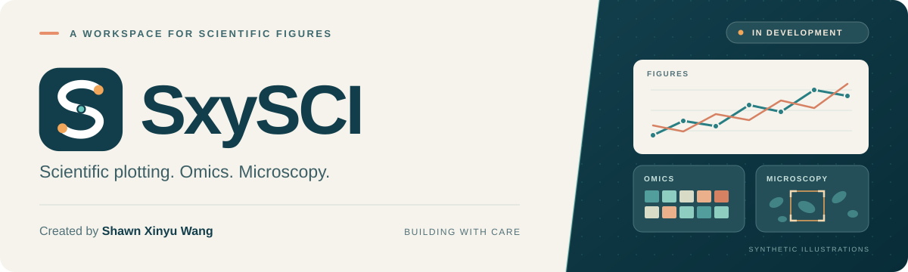

  

I explore microbial communities and build tools that make research easier to analyze, visualize, and share.

关注微生物组与组学分析，也在开发更顺手的科研绘图和显微图像工具。

### Research × software

| Explore | Build | Communicate |
| :--- | :--- | :--- |
| Microbiomes, microbial ecology, and community diversity | Scientific visualization and microscopy workflows | Reproducible analyses, clear figures, and useful documentation |

### Selected projects

| Project | Focus |
| :--- | :--- |
| [**CDI**](https://github.com/Shawnstopplaying/CDI) | Microbiota restoration and antibiotic resistance in recurrent *C. difficile* infection. |
| [**Salinity Gradient · 16S**](https://github.com/Shawnstopplaying/SalinityGradient_16S) | Exploring microbial diversity and community composition across a salinity gradient. |
| [**Ontario report**](https://github.com/Shawnstopplaying/ontraio-report) | R-based data analysis with scripts, data, and figures. |

### On my workbench

Developing desktop tools for scientific plotting, omics analysis, and microscopy image preparation. Current work focuses on reliable workflows, careful validation, and a smoother path from data to figures.

**Tools I work with:** Python · R · PySide6 · Git

From microbial communities to clearer scientific stories.
